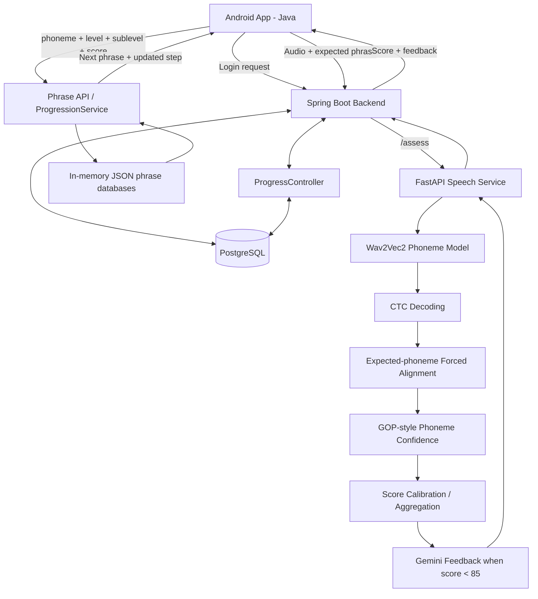

# ClearSpeak

**ClearSpeak** is an Android pronunciation-assessment application that evaluates a learner's spoken pronunciation at the phoneme level and provides immediate, targeted feedback.

The current implementation combines an Android client, a Spring Boot backend, a Python/FastAPI speech-processing service, a pretrained Wav2Vec2 phoneme-recognition model, custom CTC forced alignment, practical GOP-style phoneme confidence scoring, calibration logic, and Gemini-generated natural-language feedback.

> **Current project status:** ClearSpeak has an Android client, a Spring Boot backend, a FastAPI speech-processing service, six JSON phrase datasets (`/sh/`, `/r/`, `/l/`, `/th/`, `/s/`, and `/z/`), login handling, and PostgreSQL-backed user/phoneme progress. The phrase JSON files are loaded into memory by `PhraseDatabaseService` at Spring Boot startup. The extended datasets and pronunciation-score calibration still need broader audio-based validation.

---

## 📱 Current App Snapshot

<p align="center">
  
</p>

The current practice screen presents the target phoneme, the phrase/word to pronounce, a **Hear It** button for reference pronunciation, a **Record** button for capturing speech, and an assessment area for the returned score and feedback.

---

## 🎯 What Problem Does ClearSpeak Solve?

Traditional pronunciation-practice applications often stop at speech recognition or a simple transcript comparison. ClearSpeak is designed around a more focused question:

> **Did the learner produce the target sound correctly, and what should they change?**

Instead of treating pronunciation as a single sentence-level similarity score, the pipeline converts speech into a sequence of phoneme predictions, aligns the expected phoneme sequence against the model output, identifies insertions/substitutions, computes per-phoneme confidence, and then turns the result into learner-friendly feedback.

For example, a test on **shape** produced:

```text
Expected phonemes: ʃ eɪ p
Detected phonemes: ʃ iː p

Score: 71.71
Error: substitution of eɪ with iː
```

The feedback layer then generated targeted advice explaining that the middle vowel should sound like the long **"ay"** in words such as *say* or *day*.

---

# 🏗️ System Architecture



### High-level flow

1. The learner opens ClearSpeak and logs in.
2. The app retrieves the user's saved progress for the selected phoneme.
3. The learner selects one of the six supported phonemes: `/sh/`, `/r/`, `/l/`, `/th/`, `/s/`, or `/z/`.
4. Spring Boot selects a phrase from the corresponding in-memory JSON database and current level/sublevel.
5. The Android app displays the phrase and records the learner's speech as a WAV file.
6. Spring Boot forwards the audio and expected phrase to FastAPI.
7. FastAPI runs the pretrained Wav2Vec2 phoneme model and obtains CTC outputs.
8. Custom CTC forced alignment aligns the expected phonemes with the model's acoustic output.
9. GOP-style phoneme confidence, error detection, and calibration are used to calculate a pronunciation score.
10. Scores of 85 or above use a fixed positive response; lower scores can request targeted feedback from Gemini.
11. The assessment result returns to Android.
12. The result is sent to the progress API, which stores the user's progress by phoneme in PostgreSQL and supports continuing practice later.

---

# 🧠 Core Technical Components

## 1. Android Client

The Android application is responsible for the user-facing workflow:

- presenting the login and phoneme-selection flow
- displaying the selected target phoneme and phrase
- providing text-to-speech reference pronunciation
- recording 16 kHz mono PCM16 WAV audio
- uploading the recording and displaying the returned score and feedback
- loading saved progress for the logged-in user and selected phoneme
- requesting the next phrase and sending assessment scores to the backend progress API

The client uses Retrofit for HTTP communication and Android ViewModels for separating network state from the activity UI.

### Audio format

```text
Sample rate: 16,000 Hz
Channels:    Mono
Encoding:    PCM 16-bit
Container:   WAV
```

The format is chosen to match the speech model's expected audio conditions.

---

## 2. Spring Boot Backend

The Spring Boot service sits between Android and the Python speech-processing service.

Its responsibilities include:

- accepting assessment requests and forwarding audio to FastAPI
- exposing the phrase-selection API
- loading all six JSON phrase databases into memory at startup
- validating that every phrase database contains 5 levels, 10 sub-levels per level, and 6 phrases per sub-level
- implementing adaptive level/sublevel progression
- normalizing phoneme identifiers such as `sh` and `/sh/`
- handling login requests and retrieving user records
- loading and updating persistent per-user, per-phoneme progress in PostgreSQL

### Assessment endpoint

The existing assessment path forwards:

```text
Audio file
Expected phrase
```

to the Python service and returns the assessment response to Android.

### Phrase endpoint

```http
GET /phrases/next
```

Parameters:

| Parameter | Type | Description |
|---|---|---|
| `phoneme` | string | Target phoneme, e.g. `sh` or `/sh/` |
| `level` | int | Learning level from 1 to 5 |
| `subLevel` | int | Step from 1 to 10 |
| `excludeIndex` | Integer | Optional previous phrase index to avoid immediate repetition |
| `score` | Double | Optional score used to calculate progression |

Example:

```text
/phrases/next?phoneme=sh&level=1&subLevel=3&score=85
```

If the score is supplied, Spring Boot calculates the new target level/sublevel before selecting the next phrase.

### Authentication and persistent progress

The Android app includes a login flow backed by `AuthController`. User records are accessed through `UserRepository`, while `ProgressController` and the user-phoneme progress model handle saved progress.

The main persistence pieces are:

- `User` — user account record
- `UserRepository` — access to user records
- `UserPhonemeProgress` and `UserPhonemeProgressId` — progress associated with a particular user and phoneme
- `UserPhonemeProgressRepository` — read/write access to saved progress
- `ProgressController` — API used by the app to retrieve and update practice progress

PostgreSQL stores user and progress data. Phrase content is separate: it is loaded from JSON into memory at Spring Boot startup.

A progress lookup for user ID `2`, for example, is available at:

```http
GET /progress/2
```

Use an existing user ID from the local database when testing. Do not assume IDs are the same across development databases.

---

# 📈 Adaptive Difficulty / Progression Engine

Each supported phoneme uses **5 levels × 10 sublevels × 6 candidate phrases**. With six phrase files, the structure holds 300 phrase prompts per phoneme, or 1,800 across the full set when every file passes validation.

Supported phonemes: `/sh/`, `/r/`, `/l/`, `/th/`, `/s/`, and `/z/`. Each user's current progress is tracked independently for each phoneme.

## Level structure

| Level | Difficulty concept |
|---|---|
| Level 1 | Single-syllable words |
| Level 2 | Two-syllable words/units with increased target-sound exposure |
| Level 3 | Three-syllable words/units with further target-sound exposure |
| Level 4 | Short sentences with increasing length and complexity |
| Level 5 | Tongue twisters with increasing difficulty |

Each sublevel contains **6 phrases**. The backend selects one at random and can exclude the immediately previous phrase index.

## Score-based progression

```text
Score >= 80
    → advance one sublevel

Score 50–79
    → remain at the same sublevel

Score < 50
    → move back one sublevel
```

Boundary behavior:

```text
Level 1 / Step 1 + score < 50
    → remains Level 1 / Step 1

Level 1–4 / Step 10 + score >= 80
    → advances to the next level / Step 1

Level 5 / Step 10 + score >= 80
    → remains at the maximum level / Step 10
```

The progression rules are centralized in the backend rather than embedded in the Android activity. User progress is also persisted through the progress API, so the app can retrieve a saved level/sublevel for a user and phoneme.

---

# 🗂️ Phrase Database Design

Phrase content is stored in JSON resources and loaded into memory by `PhraseDatabaseService` when Spring Boot starts. The app does not need a database query for every phrase request.

The six files live in `backend/src/main/resources/phrases/`:

```text
phrases/
├── clearspeak_sh_phrase_database.json
├── clearspeak_r_phrase_database.json
├── clearspeak_l_phrase_database.json
├── clearspeak_th_phrase_database.json
├── clearspeak_s_phrase_database.json
└── clearspeak_z_phrase_database.json
```

Each file is structured for 5 levels, 10 sub-levels per level, and 6 phrases per sub-level. The service validates this structure at startup and fails fast if a configured file is missing or malformed.

The model is structured as:

```text
PhraseDatabase
└── levels[5]
    ├── Level 1
    │   └── subLevels[10]
    │       └── phrases[6]
    ├── Level 2
    ├── Level 3
    ├── Level 4
    └── Level 5
```

The database service validates the structural requirements when the Spring Boot application starts. This catches malformed databases early instead of allowing invalid phrase data to reach the mobile client.

### SH-specific progression design

The current SH dataset was intentionally constrained so target-sound exposure increases with the level:

- **Level 1:** exactly one `sh` occurrence per phrase
- **Level 2:** exactly two `sh` occurrences
- **Level 3:** exactly three `sh` occurrences
- **Level 4:** SH-focused short sentences
- **Level 5:** SH-focused tongue twisters

This lets difficulty increase not only through sentence length, but also through repeated target-sound production.

---

# 🎙️ Speech Processing Pipeline

## Wav2Vec2

The project uses the pretrained/fine-tuned phoneme model:

```text
facebook/wav2vec2-lv-60-espeak-cv-ft
```

The model produces CTC logits over the phoneme vocabulary.

The project does **not** train a new speech model from scratch. Instead, the pretrained phoneme-recognition model is used as the acoustic/phonetic backbone, while ClearSpeak implements its own alignment and scoring pipeline around the model output.

---

## CTC Decoding

The model output has the general structure:

```text
[batch, time_frames, vocabulary]
```

The pipeline obtains:

- raw logits
- greedy phoneme predictions
- decoded phoneme IDs

Example:

```text
Expected: ʃ ɪ p
Detected: ʃ ɪ p
```

or, in an imperfect pronunciation:

```text
Expected: ʃ eɪ p
Detected: ʃ iː p
```

---

# 🔗 Custom CTC Forced Alignment

Greedy decoding alone does not provide enough information to say exactly where the expected phonemes occur in time.

ClearSpeak therefore performs expected-phoneme forced alignment against the CTC logits.

Conceptually:

```text
Audio
  ↓
CTC logits over time
  ↓
Expected phoneme sequence
  ↓
Viterbi-style alignment
  ↓
Best frame/path for each expected phoneme
```

The alignment output contains frame-level information that can then be used for phoneme confidence scoring.

This is particularly useful because the scoring stage needs to reason about **the expected pronunciation**, not simply accept whatever greedy decoding happened to produce.

---

# 📊 Practical GOP-style Phoneme Scoring

For each aligned phoneme, the implementation compares the target phoneme probability against a strong competing nonblank phoneme at the aligned frame.

Conceptually:

```text
Target confidence
      vs.
Best competing phoneme
```

The current implementation is intentionally described as **GOP-style / practical**, not as a canonical or clinically validated implementation of Goodness of Pronunciation.

That distinction matters: the project demonstrates a working research/engineering pipeline, but the score should not be presented as a clinical speech-therapy measurement without proper validation.

---

# 📐 Score Calibration

The project also contains a calibration layer that maps raw phoneme confidence against baseline behavior for selected phonemes.

The calibrated values are then aggregated using phoneme weights.

The current V1 scorer is intentionally simple and practical for the project/demo. It is not presented as a scientifically validated calibration model.

This architecture leaves room for later improvements such as:

- speaker-normalized calibration
- larger reference datasets
- phoneme-specific distributions
- confidence intervals
- calibration curves
- validation against human-rated pronunciation

---

# 🤖 Gemini Feedback Layer

The scoring engine produces structured errors such as insertions and substitutions and records the expected/actual phonemes. Gemini can turn these results into learner-friendly feedback when additional guidance is useful.

To limit unnecessary model calls, the current assessment path bypasses Gemini when the overall score is **85 or higher** and returns a fixed positive message. For scores below 85, it attempts Gemini feedback. If the feedback call fails or returns no usable text, the service falls back to a generic practice message. The pronunciation score and progression flow should not depend on Gemini succeeding.

Example from the current running pipeline:

```text
Expected: ʃ eɪ p
Actual:   ʃ iː p
Score:    71.71
```

The generated guidance focused specifically on the middle vowel and explained the contrast in a way a learner can act on.

This creates a two-layer result:

```text
Objective analysis
    ↓
Structured pronunciation errors
    ↓
Human-friendly explanation
```

Gemini is therefore used for **feedback generation**, not as the primary pronunciation scorer.

---

# 🧪 End-to-End Test Evidence

<p align="center">
  
</p>

The current development test produced the following real pipeline results:

| Phrase | Score | Observed issue |
|---|---:|---|
| `shed` | 97.13 | Inserted `ɡ` after the expected sequence |
| `shell` | 95.48 | No detected phoneme errors |
| `shape` | 71.71 | `eɪ` was detected as `iː` |

These tests demonstrate that the system is not simply returning a static score: the phoneme sequence and structured error output change with the spoken pronunciation.

---

# 📱 Mobile-to-Laptop Networking

The current development setup uses a physical Android phone connected to the same network as the laptop running the backend services.

For local testing, the phone must be able to reach the laptop's Spring Boot port.

```text
Phone
  │
  │ HTTP
  ▼
Laptop IP : 8080
  │
  ├── Spring Boot
  │
  └── localhost:8000 → FastAPI
```

The exact laptop IP can change whenever the network/hotspot changes, so it should not be hard-coded into documentation.

For Android development, update the Retrofit base URL to the laptop's **current LAN/hotspot IP** when required.

---

# ▶️ Local Development Setup

## 1. Android

Open the Android project in Android Studio.

The Android client communicates with the Spring Boot backend through Retrofit.

A physical phone is currently the simplest development target because the app needs access to the laptop's local network services.

Make sure:

- Developer Options are enabled
- USB debugging is enabled
- the phone is visible to Android Studio
- the phone and laptop are on the same network

---

## 2. Spring Boot

Open the `backend` project and run the Spring Boot application.

The current configuration exposes:

```text
Port: 8080
Address: 0.0.0.0
```

The six configured JSON phrase databases are loaded during startup and structurally validated. The startup log should list all supported keys: `sh`, `r`, `l`, `th`, `s`, and `z`. If a key is missing, check the `PHRASE_FILES` map and the matching filename under `src/main/resources/phrases/`.

---

## 3. FastAPI / Python

Run the Python speech-processing service so that it listens on port `8000`.

The Spring Boot service forwards assessment requests to the Python service.

The Python service loads the Wav2Vec2 model and processes the uploaded WAV file.

For local development, keep Python dependencies inside a virtual environment rather than committing the environment directory to Git.

---

# 🧪 Useful Development Checks

### Check Spring Boot port

```powershell
netstat -ano | findstr :8080
```

You should see a listener such as:

```text
0.0.0.0:8080    LISTENING
```

### Test the phrase API locally

Test one phrase from each JSON database:

```text
http://localhost:8080/phrases/next?phoneme=sh&level=1&subLevel=1
http://localhost:8080/phrases/next?phoneme=r&level=1&subLevel=1
http://localhost:8080/phrases/next?phoneme=l&level=1&subLevel=1
http://localhost:8080/phrases/next?phoneme=th&level=1&subLevel=1
http://localhost:8080/phrases/next?phoneme=s&level=1&subLevel=1
http://localhost:8080/phrases/next?phoneme=z&level=1&subLevel=1
```

### Check saved progress

For a known user ID, the progress GET endpoint can be checked with an address such as:

```text
http://localhost:8080/progress/2
```

Use an actual user ID from your local database when testing.

### Test progression

```text
http://localhost:8080/phrases/next?phoneme=sh&level=1&subLevel=3&score=85
```

Expected progression:

```text
1 / 3  →  1 / 4
```

Likewise:

```text
score=65 → 1 / 3
score=40 → 1 / 2
```

---

# 📁 Repository Structure

```text
ClearSpeak/
│
├── Android app
│   ├── ApiService.java
│   ├── PhraseResponse.java
│   ├── PhraseViewModel.java
│   ├── PracticeActivity.java
│   ├── ScoreViewModel.java
│   └── ...
│
├── backend/
│   ├── src/main/java/com/example/clearspeak/
│   │   ├── AuthController.java
│   │   ├── LoginRequest.java
│   │   ├── LoginResponse.java
│   │   ├── ProgressController.java
│   │   ├── ProgressResponse.java
│   │   ├── User.java
│   │   ├── UserRepository.java
│   │   ├── UserPhonemeProgress.java
│   │   ├── UserPhonemeProgressId.java
│   │   ├── UserPhonemeProgressRepository.java
│   │   ├── PhraseController.java
│   │   ├── PhraseDatabase.java
│   │   ├── PhraseDatabaseService.java
│   │   ├── PhraseResponse.java
│   │   └── ProgressionService.java
│   │
│   └── src/main/resources/
│       ├── application.properties
│       └── phrases/
│           ├── clearspeak_sh_phrase_database.json
│           ├── clearspeak_r_phrase_database.json
│           ├── clearspeak_l_phrase_database.json
│           ├── clearspeak_th_phrase_database.json
│           ├── clearspeak_s_phrase_database.json
│           └── clearspeak_z_phrase_database.json
│
├── app.py
├── transcribe_test.py
├── ctc_align_test.py
├── pronunciation_scorer.py
├── pronunciation_scorer_v1.py
├── baseline_test.py
├── gop_test.py
├── phoneme_check.py
├── test_v1_scorer.py
└── espeak_ship.txt
```

The repository intentionally separates:

```text
Mobile application
        ↕
Backend/API layer
        ↕
Speech-processing layer
```

This separation makes the scoring service independently testable and keeps Android-specific code out of the machine-learning pipeline.

---

# 🔐 Configuration & Secrets

Do **not** commit:

- API keys
- access tokens
- local `.env` files containing secrets
- Python virtual environments
- generated audio recordings
- IDE-specific transient files
- large experiment outputs that are not part of the source project

Use environment variables or a local configuration file for service credentials.

---

# ⚠️ Current Limitations

### 1. Extended phrase datasets need broader smoke testing

All six phoneme JSON files are registered in the Spring Boot loader and are expected to follow the same 5 × 10 × 6 structure. Confirm that startup logs list every phoneme and exercise every dataset through the phrase API and physical Android app. Structural validation does not guarantee linguistic quality or scoring accuracy.

### 2. Scoring is not clinically validated

The current score is a project/research-style engineering measure, not a clinical diagnostic measurement. Human-rated reference audio and broader speaker testing are still needed.

### 3. Calibration is an early implementation

The V1 calibration is a practical prototype. Add good and mispronounced audio examples for each target phoneme, including different speakers and recording conditions, before revising thresholds or presenting the score as validated.

### 4. Local-network development

The current development setup expects the Android device to reach a laptop-hosted backend. Production deployment would replace this with a stable hosted API and secure transport.

### 5. Deployment/security hardening remains

Keep credentials out of version control and review authentication, password handling, HTTPS, logging, and production database configuration before deployment.

---

# 🚀 Future Roadmap

## Phase 1 — Current implementation

- [x] Android pronunciation practice screen and text-to-speech reference pronunciation
- [x] 16 kHz mono PCM16 WAV recording
- [x] Spring Boot backend and FastAPI speech-processing service
- [x] Wav2Vec2 phoneme recognition and CTC forced alignment
- [x] Phoneme-level error detection and practical GOP-style scoring
- [x] Score calibration prototype
- [x] Gemini feedback path with a score-based call guard and fallback message
- [x] Six JSON phrase databases (`sh`, `r`, `l`, `th`, `s`, `z`)
- [x] JSON loading and structural validation at startup
- [x] Adaptive level/sublevel progression
- [x] Login flow and PostgreSQL-backed user/phoneme progress

## Phase 2 — Productization

- [ ] Assessment history and progress charts
- [ ] Better phrase authoring and validation tools
- [ ] Stronger automated tests for API, progression, and database behavior
- [ ] Authentication and configuration security review
- [ ] Improve user-facing loading/error states

## Phase 3 — Research / Validation

- [ ] Larger pronunciation reference dataset
- [ ] Speaker-independent validation
- [ ] Human-rated pronunciation benchmark
- [ ] Formal calibration evaluation
- [ ] Error analysis by phoneme and accent
- [ ] Comparison against baseline pronunciation metrics

## Phase 4 — Deployment

- [ ] Hosted FastAPI inference service
- [ ] Hosted Spring Boot API
- [ ] Production database
- [ ] Secure configuration management
- [ ] HTTPS
- [ ] Monitoring and logging

---

# 🎬 Suggested Demo Flow

For a project demonstration, the cleanest story is:

### 1. Log in and choose a phoneme

Sign in using the app's login screen, then select one of the six supported phonemes.

### 2. Show the saved level and phrase

Show the current level/sublevel and the phrase loaded from the selected phoneme's JSON database.

### 3. Use “Hear It” and record

Play the reference pronunciation, then record the learner speaking the phrase.

### 4. Show the assessment result

Display the numeric score, detected phoneme errors, and feedback. For scores below 85, show the Gemini feedback path; higher scores use the fixed positive message.

### 5. Explain the phoneme error

Use a sample such as:

```text
Expected: ʃ eɪ p
Actual:   ʃ iː p
```

### 6. Demonstrate adaptation

Explain the progression rules implemented in the backend:

```text
80+   → advance
50–79 → stay
<50   → move back
```

### 7. Show persistent progress

Open the progress screen or check the progress API to show the saved level/sublevel for that user and phoneme.

---

# 👨‍💻 Project Positioning

ClearSpeak is best described as an **AI-assisted phoneme-level pronunciation assessment and adaptive practice system**.

The key engineering contribution is not training a speech model from scratch. The project integrates several components into a single working pipeline:

```text
Pretrained phoneme model
        +
Custom CTC alignment
        +
Phoneme-level confidence scoring
        +
Calibration layer
        +
Generative feedback
        +
Adaptive phrase progression
        +
Android application
```

This makes the project a full-stack ML application rather than a standalone model experiment.

---

# 📜 License

Add the project's chosen license here before distributing the repository publicly.

---

## 📸 Screenshots

### Practice screen

<p align="center">
  
</p>

### End-to-end scoring evidence

<p align="center">
  
</p>

---

## 🙌 Project Status

ClearSpeak is under active development. The current implementation brings together Android recording and login, Spring Boot APIs, PostgreSQL-backed user/phoneme progress, six startup-loaded JSON phrase databases, FastAPI, Wav2Vec2-based phoneme analysis, score calibration, Gemini-assisted feedback, and adaptive phrase progression. The expanded phrase datasets and scoring calibration remain candidates for broader audio-based evaluation.
