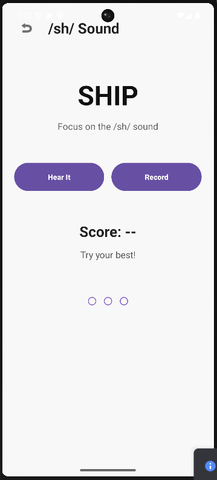
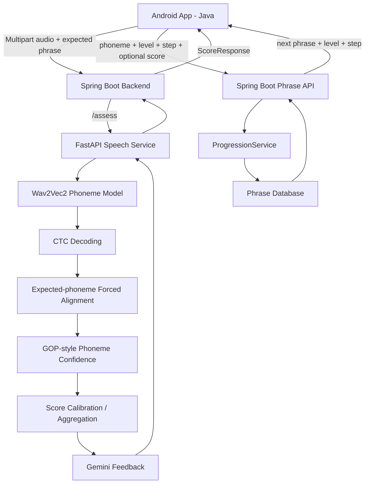
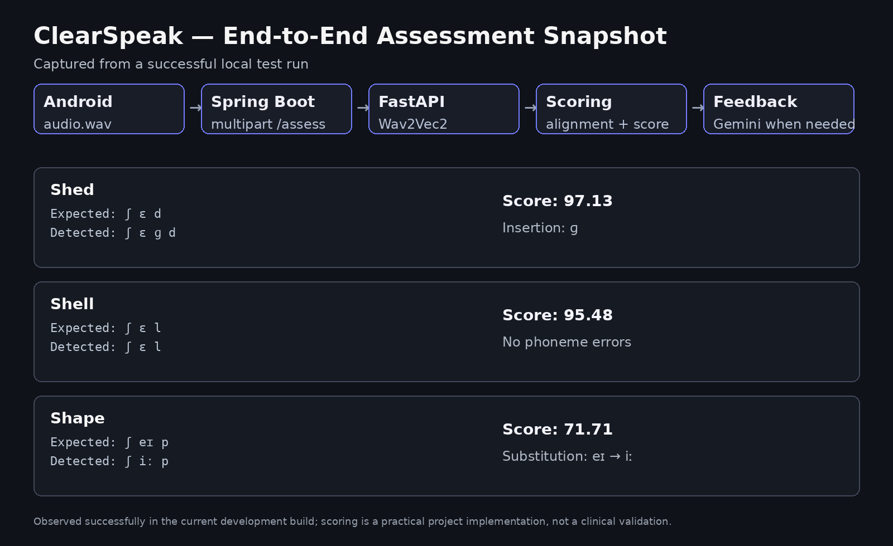

# ClearSpeak

**ClearSpeak** is an Android pronunciation-assessment application that evaluates a learner's spoken pronunciation at the phoneme level and provides immediate, targeted feedback.

The current implementation combines an Android client, a Spring Boot backend, a Python/FastAPI speech-processing service, a pretrained Wav2Vec2 phoneme-recognition model, custom CTC forced alignment, practical GOP-style phoneme confidence scoring, calibration logic, and Gemini-generated natural-language feedback.

> **Current project status:** The end-to-end pipeline is working on a physical Android phone. The current phrase-database implementation is populated for the `/sh/` phoneme, while the backend API and progression engine are designed so additional phoneme databases can be added using the same structure.

---

## 📱 Current App Snapshot

<p align="center">
  
</p>

The current practice screen presents the target phoneme, the phrase/word to pronounce, a **Hear It** button for reference pronunciation, a **Record** button for capturing speech, and an assessment area for the returned score and feedback.

---

## 🎯 What Problem Does ClearSpeak Solve?

Traditional pronunciation-practice applications often stop at speech recognition or a simple transcript comparison. ClearSpeak is designed around a more focused question:

> **Did the learner produce the target sound correctly, and what should they change?**

Instead of treating pronunciation as a single sentence-level similarity score, the pipeline converts speech into a sequence of phoneme predictions, aligns the expected phoneme sequence against the model output, identifies insertions/substitutions, computes per-phoneme confidence, and then turns the result into learner-friendly feedback.

For example, a test on **shape** produced:

```text
Expected phonemes: ʃ eɪ p
Detected phonemes: ʃ iː p

Score: 71.71
Error: substitution of eɪ with iː
```

The feedback layer then generated targeted advice explaining that the middle vowel should sound like the long **"ay"** in words such as *say* or *day*.

---

# 🏗️ System Architecture



### High-level flow

1. The learner chooses a target phoneme in the Android application.
2. Spring Boot provides a phrase from the appropriate level/sublevel.
3. The Android app displays the phrase and records the learner's speech as a WAV file.
4. Spring Boot forwards the multipart audio and expected phrase to FastAPI.
5. FastAPI loads the audio and runs the pretrained Wav2Vec2 phoneme model.
6. The raw CTC output is converted into a phoneme sequence and frame-level logits.
7. Custom CTC Viterbi-style forced alignment aligns the **expected** phonemes with the model's acoustic output.
8. A practical GOP-style confidence is computed for each aligned phoneme.
9. Calibrated phoneme scores are aggregated into the pronunciation score.
10. Pronunciation errors are used to generate more specific feedback through Gemini when appropriate.
11. The result is returned to Android.
12. The score is passed to the Spring Boot progression engine, which decides the next learning step and selects a new phrase.

---

# 🧠 Core Technical Components

## 1. Android Client

The Android application is responsible for the user-facing workflow:

- displaying the target phoneme and phrase
- text-to-speech reference pronunciation
- recording 16 kHz mono PCM16 audio
- uploading the recording
- displaying the returned score and feedback
- holding the current in-memory level/sublevel during a no-login session
- requesting the next phrase from the backend

The client uses Retrofit for HTTP communication and Android ViewModels for separating network state from the activity UI.

### Audio format

```text
Sample rate: 16,000 Hz
Channels:    Mono
Encoding:    PCM 16-bit
Container:   WAV
```

The format is chosen to match the speech model's expected audio conditions.

---

## 2. Spring Boot Backend

The Spring Boot service sits between Android and the Python speech-processing service.

Its responsibilities include:

- accepting multipart assessment requests
- forwarding audio to FastAPI
- exposing the phrase-selection API
- loading and validating phrase databases from resources
- implementing adaptive level/sublevel progression
- choosing a non-repeating phrase from the current six-phrase pool
- normalizing phoneme identifiers such as `sh` and `/sh/`

### Assessment endpoint

The existing assessment path forwards:

```text
Audio file
Expected phrase
```

to the Python service and returns the assessment response to Android.

### Phrase endpoint

```http
GET /phrases/next
```

Parameters:

| Parameter | Type | Description |
|---|---|---|
| `phoneme` | string | Target phoneme, e.g. `sh` or `/sh/` |
| `level` | int | Learning level from 1 to 5 |
| `subLevel` | int | Step from 1 to 10 |
| `excludeIndex` | Integer | Optional previous phrase index to avoid immediate repetition |
| `score` | Double | Optional score used to calculate progression |

Example:

```text
/phrases/next?phoneme=sh&level=1&subLevel=3&score=85
```

If the score is supplied, Spring Boot calculates the new target level/sublevel before selecting the next phrase.

---

# 📈 Adaptive Difficulty / Progression Engine

The current learning system uses **5 levels × 10 sublevels × 6 candidate phrases**.

The phrase content is currently implemented for the `/sh/` phoneme.

## Level structure

| Level | Difficulty concept |
|---|---|
| Level 1 | Single-syllable words |
| Level 2 | Two-syllable words/units with increased target-sound exposure |
| Level 3 | Three-syllable words/units with further target-sound exposure |
| Level 4 | Short sentences with increasing length and complexity |
| Level 5 | Tongue twisters with increasing difficulty |

Each sublevel contains **6 phrases**. The backend selects one at random and can exclude the immediately previous phrase index.

## Score-based progression

```text
Score >= 80
    → advance one sublevel

Score 50–79
    → remain at the same sublevel

Score < 50
    → move back one sublevel
```

Boundary behavior:

```text
Level 1 / Step 1 + score < 50
    → remains Level 1 / Step 1

Level 5 / Step 10 + score >= 80
    → remains Level 5 / Step 10
```

The progression rules are deliberately located in `ProgressionService` rather than inside the Android activity. This keeps learning logic centralized and makes a future login/persistence implementation much easier.

---

# 🗂️ Phrase Database Design

The phrase database is stored in Spring Boot resources as JSON.

Current file:

```text
backend/src/main/resources/phrases/
└── clearspeak_sh_phrase_database.json
```

The model is structured as:

```text
PhraseDatabase
└── levels[5]
    ├── Level 1
    │   └── subLevels[10]
    │       └── phrases[6]
    ├── Level 2
    ├── Level 3
    ├── Level 4
    └── Level 5
```

The database service validates the structural requirements when the Spring Boot application starts. This catches malformed databases early instead of allowing invalid phrase data to reach the mobile client.

### SH-specific progression design

The current SH dataset was intentionally constrained so target-sound exposure increases with the level:

- **Level 1:** exactly one `sh` occurrence per phrase
- **Level 2:** exactly two `sh` occurrences
- **Level 3:** exactly three `sh` occurrences
- **Level 4:** SH-focused short sentences
- **Level 5:** SH-focused tongue twisters

This lets difficulty increase not only through sentence length, but also through repeated target-sound production.

---

# 🎙️ Speech Processing Pipeline

## Wav2Vec2

The project uses the pretrained/fine-tuned phoneme model:

```text
facebook/wav2vec2-lv-60-espeak-cv-ft
```

The model produces CTC logits over the phoneme vocabulary.

The project does **not** train a new speech model from scratch. Instead, the pretrained phoneme-recognition model is used as the acoustic/phonetic backbone, while ClearSpeak implements its own alignment and scoring pipeline around the model output.

---

## CTC Decoding

The model output has the general structure:

```text
[batch, time_frames, vocabulary]
```

The pipeline obtains:

- raw logits
- greedy phoneme predictions
- decoded phoneme IDs

Example:

```text
Expected: ʃ ɪ p
Detected: ʃ ɪ p
```

or, in an imperfect pronunciation:

```text
Expected: ʃ eɪ p
Detected: ʃ iː p
```

---

# 🔗 Custom CTC Forced Alignment

Greedy decoding alone does not provide enough information to say exactly where the expected phonemes occur in time.

ClearSpeak therefore performs expected-phoneme forced alignment against the CTC logits.

Conceptually:

```text
Audio
  ↓
CTC logits over time
  ↓
Expected phoneme sequence
  ↓
Viterbi-style alignment
  ↓
Best frame/path for each expected phoneme
```

The alignment output contains frame-level information that can then be used for phoneme confidence scoring.

This is particularly useful because the scoring stage needs to reason about **the expected pronunciation**, not simply accept whatever greedy decoding happened to produce.

---

# 📊 Practical GOP-style Phoneme Scoring

For each aligned phoneme, the implementation compares the target phoneme probability against a strong competing nonblank phoneme at the aligned frame.

Conceptually:

```text
Target confidence
      vs.
Best competing phoneme
```

The current implementation is intentionally described as **GOP-style / practical**, not as a canonical or clinically validated implementation of Goodness of Pronunciation.

That distinction matters: the project demonstrates a working research/engineering pipeline, but the score should not be presented as a clinical speech-therapy measurement without proper validation.

---

# 📐 Score Calibration

The project also contains a calibration layer that maps raw phoneme confidence against baseline behavior for selected phonemes.

The calibrated values are then aggregated using phoneme weights.

The current V1 scorer is intentionally simple and practical for the project/demo. It is not presented as a scientifically validated calibration model.

This architecture leaves room for later improvements such as:

- speaker-normalized calibration
- larger reference datasets
- phoneme-specific distributions
- confidence intervals
- calibration curves
- validation against human-rated pronunciation

---

# 🤖 Gemini Feedback Layer

The scoring engine produces structured errors such as:

```text
insertion
substitution
```

and records the expected/actual phonemes.

Gemini can then turn these structured results into learner-friendly feedback.

Example from the current running pipeline:

```text
Expected: ʃ eɪ p
Actual:   ʃ iː p
Score:    71.71
```

The generated guidance focused specifically on the middle vowel and explained the contrast in a way a learner can act on.

This creates a two-layer result:

```text
Objective analysis
    ↓
Structured pronunciation errors
    ↓
Human-friendly explanation
```

Gemini is therefore used for **feedback generation**, not as the primary pronunciation scorer.

---

# 🧪 End-to-End Test Evidence

<p align="center">
  
</p>

The current development test produced the following real pipeline results:

| Phrase | Score | Observed issue |
|---|---:|---|
| `shed` | 97.13 | Inserted `ɡ` after the expected sequence |
| `shell` | 95.48 | No detected phoneme errors |
| `shape` | 71.71 | `eɪ` was detected as `iː` |

These tests demonstrate that the system is not simply returning a static score: the phoneme sequence and structured error output change with the spoken pronunciation.

---

# 📱 Mobile-to-Laptop Networking

The current development setup uses a physical Android phone connected to the same network as the laptop running the backend services.

For local testing, the phone must be able to reach the laptop's Spring Boot port.

```text
Phone
  │
  │ HTTP
  ▼
Laptop IP : 8080
  │
  ├── Spring Boot
  │
  └── localhost:8000 → FastAPI
```

The exact laptop IP can change whenever the network/hotspot changes, so it should not be hard-coded into documentation.

For Android development, update the Retrofit base URL to the laptop's **current LAN/hotspot IP** when required.

---

# ▶️ Local Development Setup

## 1. Android

Open the Android project in Android Studio.

The Android client communicates with the Spring Boot backend through Retrofit.

A physical phone is currently the simplest development target because the app needs access to the laptop's local network services.

Make sure:

- Developer Options are enabled
- USB debugging is enabled
- the phone is visible to Android Studio
- the phone and laptop are on the same network

---

## 2. Spring Boot

Open the `backend` project and run the Spring Boot application.

The current configuration exposes:

```text
Port: 8080
Address: 0.0.0.0
```

The phrase database is loaded during startup and structurally validated.

A successful startup should indicate that the phrase database(s) were loaded.

---

## 3. FastAPI / Python

Run the Python speech-processing service so that it listens on port `8000`.

The Spring Boot service forwards assessment requests to the Python service.

The Python service loads the Wav2Vec2 model and processes the uploaded WAV file.

For local development, keep Python dependencies inside a virtual environment rather than committing the environment directory to Git.

---

# 🧪 Useful Development Checks

### Check Spring Boot port

```powershell
netstat -ano | findstr :8080
```

You should see a listener such as:

```text
0.0.0.0:8080    LISTENING
```

### Test the phrase API locally

```text
http://localhost:8080/phrases/next?phoneme=sh&level=1&subLevel=1
```

### Test progression

```text
http://localhost:8080/phrases/next?phoneme=sh&level=1&subLevel=3&score=85
```

Expected progression:

```text
1 / 3  →  1 / 4
```

Likewise:

```text
score=65 → 1 / 3
score=40 → 1 / 2
```

---

# 📁 Repository Structure

```text
ClearSpeak/
│
├── Android app
│   ├── ApiService.java
│   ├── PhraseResponse.java
│   ├── PhraseViewModel.java
│   ├── PracticeActivity.java
│   ├── ScoreViewModel.java
│   └── ...
│
├── backend/
│   ├── src/main/java/com/example/clearspeak/
│   │   ├── PhraseController.java
│   │   ├── PhraseDatabase.java
│   │   ├── PhraseDatabaseService.java
│   │   ├── PhraseResponse.java
│   │   └── ProgressionService.java
│   │
│   └── src/main/resources/
│       ├── application.properties
│       └── phrases/
│           └── clearspeak_sh_phrase_database.json
│
├── app.py
├── transcribe_test.py
├── ctc_align_test.py
├── pronunciation_scorer.py
├── pronunciation_scorer_v1.py
├── baseline_test.py
├── gop_test.py
├── phoneme_check.py
├── test_v1_scorer.py
└── espeak_ship.txt
```

The repository intentionally separates:

```text
Mobile application
        ↕
Backend/API layer
        ↕
Speech-processing layer
```

This separation makes the scoring service independently testable and keeps Android-specific code out of the machine-learning pipeline.

---

# 🔐 Configuration & Secrets

Do **not** commit:

- API keys
- access tokens
- local `.env` files containing secrets
- Python virtual environments
- generated audio recordings
- IDE-specific transient files
- large experiment outputs that are not part of the source project

Use environment variables or a local configuration file for service credentials.

---

# ⚠️ Current Limitations

### 1. Only SH phrase data is currently populated

The phrase database architecture is generic, but the current JSON content is for the `/sh/` target.

Additional phonemes require their own validated phrase databases.

### 2. No login or persistence yet

Progression is currently maintained for the current application session.

A future version can move the state to PostgreSQL using a user/phoneme progress model.

### 3. Scoring is not clinically validated

The current score should be treated as a project/research-style engineering score rather than a medical or clinical diagnostic measurement.

### 4. Local-network development

The present development environment expects the Android device to reach the laptop-hosted backend. Production deployment would replace this with a stable hosted API.

### 5. Calibration is an early implementation

The current baseline calibration/scorer is intentionally practical and can be improved with larger speaker datasets and formal validation.

---

# 🚀 Future Roadmap

## Phase 1 — Current

- [x] Android pronunciation practice screen
- [x] Text-to-speech reference pronunciation
- [x] 16 kHz mono WAV recording
- [x] Spring Boot backend
- [x] FastAPI speech-processing service
- [x] Wav2Vec2 phoneme recognition
- [x] CTC forced alignment
- [x] Phoneme-level error detection
- [x] Practical GOP-style scoring
- [x] Score calibration prototype
- [x] Gemini feedback generation
- [x] SH phrase database
- [x] Adaptive progression engine

## Phase 2 — Productization

- [ ] Login / registration
- [ ] JWT authentication
- [ ] PostgreSQL user database
- [ ] Persistent phoneme-level progress
- [ ] Assessment history
- [ ] Progress charts
- [ ] Multiple phoneme databases
- [ ] Better phrase authoring/validation tools

## Phase 3 — Research / Validation

- [ ] Larger pronunciation reference dataset
- [ ] Speaker-independent validation
- [ ] Human-rated pronunciation benchmark
- [ ] Formal calibration evaluation
- [ ] Error analysis by phoneme and accent
- [ ] Comparison against baseline pronunciation metrics

## Phase 4 — Deployment

- [ ] Hosted FastAPI inference service
- [ ] Hosted Spring Boot API
- [ ] Production database
- [ ] Secure configuration management
- [ ] HTTPS
- [ ] Monitoring and logging

---

# 🎬 Suggested Demo Flow

For a project demonstration, the cleanest story is:

### 1. Show the practice screen

Select `/sh/` and present the displayed phrase.

### 2. Use “Hear It”

Let the application provide the reference pronunciation.

### 3. Record the learner

Speak the target phrase naturally.

### 4. Show the result

The system returns a numeric score and feedback.

### 5. Explain the phoneme error

Show that the system can distinguish a correct sequence from an error such as:

```text
Expected: ʃ eɪ p
Actual:   ʃ iː p
```

### 6. Demonstrate adaptation

Explain that the score is sent to the progression service:

```text
80+  → advance
50–79 → stay
<50  → move back
```

### 7. Show the next phrase

A new phrase is selected from the current level/sublevel pool while avoiding immediate repetition when possible.

---

# 👨‍💻 Project Positioning

ClearSpeak is best described as an **AI-assisted phoneme-level pronunciation assessment and adaptive practice system**.

The key engineering contribution is not training a speech model from scratch. The project integrates several components into a single working pipeline:

```text
Pretrained phoneme model
        +
Custom CTC alignment
        +
Phoneme-level confidence scoring
        +
Calibration layer
        +
Generative feedback
        +
Adaptive phrase progression
        +
Android application
```

This makes the project a full-stack ML application rather than a standalone model experiment.

---

# 📜 License

Add the project's chosen license here before distributing the repository publicly.

---

## 📸 Screenshots

### Practice screen

<p align="center">
  
</p>

### End-to-end scoring evidence

<p align="center">
  
</p>

---

## 🙌 Project Status

ClearSpeak is under active development. The current build demonstrates the complete local workflow from Android recording through Spring Boot, FastAPI, Wav2Vec2-based phoneme analysis, scoring, feedback generation, and adaptive phrase selection.
